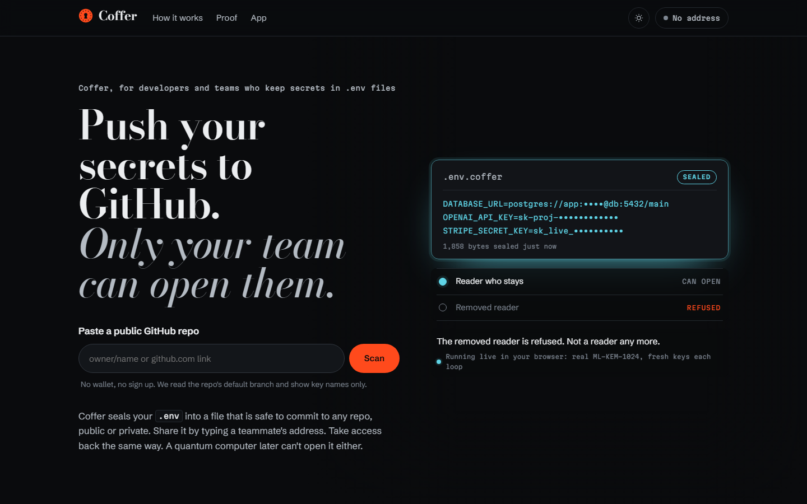
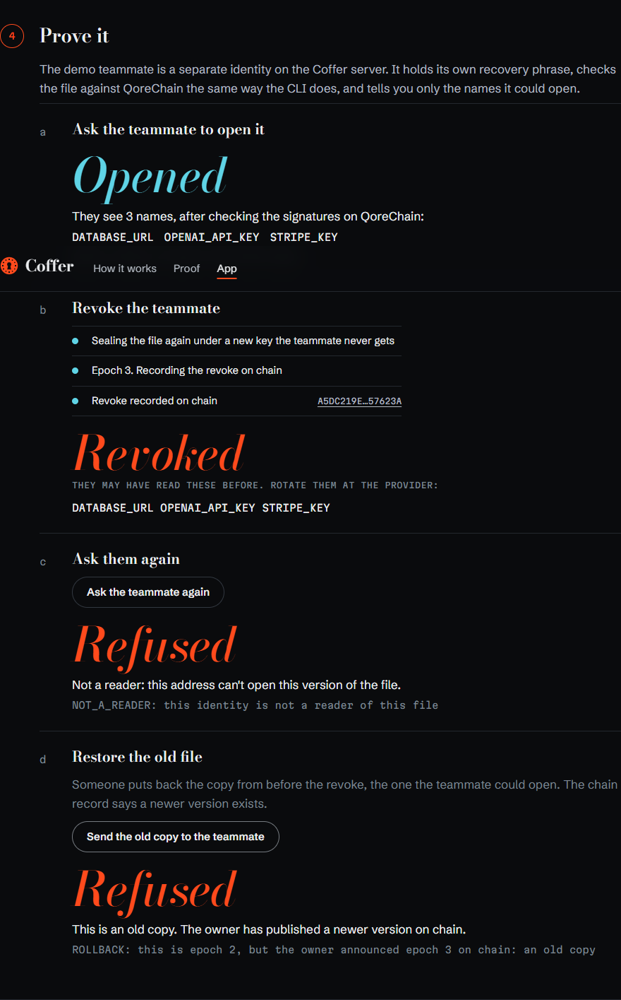

<p align="center">
  
</p>

<h1 align="center">Coffer</h1>

<p align="center">
  <b>Push your secrets to GitHub. Only your team can open them.</b><br>
  Your <code>.env</code> sealed with ML-KEM-1024 to your teammates' QoreChain addresses. Share by address, take access back, run your app with the secrets in memory only.
</p>

<p align="center">
  <a href="https://coffer.jdollar.site"></a>
  <a href="https://coffer.jdollar.site/proof"></a>
  
  
  <a href="LICENSE"></a>
</p>

<p align="center">
  
</p>

## Start here

| | |
|---|---|
| Live site | https://coffer.jdollar.site |
| Try it, no wallet, no funds | https://coffer.jdollar.site/app |
| Proof of the testnet runs | https://coffer.jdollar.site/proof and [docs/BUILD_LOG.md](docs/BUILD_LOG.md) |
| The chain spike | [docs/spikes/address-seal.md](docs/spikes/address-seal.md) |
| Product spec | [docs/PRD.md](docs/PRD.md) |

## Judge fast path (one minute, nothing to install)

1. Open **https://coffer.jdollar.site** and paste any public GitHub repo into the field under the headline. Coffer lists its env files and says which are dotenvx (sealed with secp256k1, breakable by a quantum computer) and which are plain text. Try `dotenvx/dotenvx`.
2. Open **/app** and press **Make a new address**. The Coffer relayer pays for your two setup transactions; you watch both land.
3. **Seal a file**: paste any `.env`. You get `.env.coffer`, safe to commit.
4. **Share**: press **Add the demo teammate**, a separate identity running on the Coffer server.
5. **Prove it**: ask the teammate to open the file (it sees the key names, never the values). **Revoke** them, ask again: refused. **Send the old copy**: refused again, because the chain record says a newer version exists.

## How it works

```
.env ──► sealed under a fresh epoch key ──► data      (AES-256-GCM)
          epoch key ──► sealed to each reader ──► key  (ML-KEM-1024, keys read from QoreChain)
          owner signs who can read             ──► access (ML-DSA-87)
          writer signs what was written        ──► write  (ML-DSA-87)
share / revoke ──► new epoch, reseal, and a signed record on QoreChain
```

- **Sharing needs only an address.** Every QoreChain account can publish an ML-KEM-1024 key in the chain's KEM registry (`MsgRegisterKEMKey`, signed by its ML-DSA-87 key). Coffer reads it from `/qorechain/pqc/v1/kem/{address}` and seals to it. No key swapping, no invite links, no server holding secrets.
- **Revoking means something.** A removed reader never gets the next epoch key, so they cannot open this version or any later one. Coffer lists every key in the file so you can rotate what they already saw.
- **Tampering is caught.** The owner's ML-DSA-87 signature covers the reader list; the writer's covers the contents. Readers check both against the keys registered on chain. A hand-edited reader list, or a file relabelled with someone else's name, is refused. A valid file from a different owner is a different matter: the CLI remembers each file's owner the first time it opens it and refuses a copy from anyone else.
- **Rollbacks are caught.** Every share and revoke is a hybrid-signed transaction whose memo names the file and its epoch. Before opening, Coffer reads those records, so restoring a copy from before a revoke is refused.

<p align="center"></p>

## The CLI

```bash
npx github:jenzylove/coffer init                 # make your address; the relayer pays setup
npx github:jenzylove/coffer lock                 # .env -> .env.coffer (commit this)
npx github:jenzylove/coffer share qor1...        # add a reader by address
npx github:jenzylove/coffer revoke qor1...       # remove a reader, list keys to rotate
npx github:jenzylove/coffer run -- npm start     # secrets in the child process env only
npx github:jenzylove/coffer import               # move a dotenvx .env + .env.keys over
npx github:jenzylove/coffer set KEY              # change a value (asks for it); no plain text on disk
npx github:jenzylove/coffer status               # readers, epoch, signature check, history
```

Your identity is a 24 word recovery phrase in `~/.coffer/identity`. On a server or in CI, set `COFFER_IDENTITY` instead.

## Why it needs QoreChain

The chain's ML-KEM key registry is what turns "a teammate's address" into "a key you can seal to", and its ML-DSA-87 account keys are what make every signature checkable by anyone. Without both, Coffer would need its own key server.

## The number

On 17 Nov 2026 GitHub code search returned **2,284** public files containing `DOTENV_PUBLIC_KEY` (dotenvx), and **1,716** with `encrypted:` values as well. Each is sealed with secp256k1 ECIES and sits in a public, mirrored repo. Queries: `DOTENV_PUBLIC_KEY` and `DOTENV_PUBLIC_KEY encrypted:`; code search counts are approximate.

## What is live

| Part | Status |
|---|---|
| Sealing, sharing, revoking, signatures, rollback check | Live on QoreChain testnet (`qorechain-diana`) |
| Relayer that pays new addresses' setup | Live, rate limited |
| Demo teammate | Live on the Coffer server |
| Repo scanner | Live, reads public repos through the GitHub API |
| CLI | Installs from this repo with `npx github:jenzylove/coffer` |

## Scope of this build

- Testnet only. The KEM registry has not been exercised end to end on mainnet yet.
- QoreX does not offer KEM registration or decryption to apps yet, so Coffer keeps its own recovery phrase, the same way dotenvx keeps `.env.keys`.
- No smart contracts: everything is native QoreChain transactions.
- Keys and records are read from a QoreChain REST node (the browser goes through the Coffer server); the CLI can use your own node with `COFFER_REST`.
- Files shared with the demo teammate are opened on the Coffer server by that teammate, which reports key names only.

## Built with

- [QoreSeal](https://github.com/qorechain) (`@qorechain/qoreseal`): ML-KEM-1024 envelopes, epoch keys, the KEM registry client
- [QoreSign](https://github.com/qorechain) (`@qorechain/qoresign`): hybrid secp256k1 + ML-DSA-87 signing, key registration, message signatures
- [CosmJS](https://github.com/cosmos/cosmjs) and `cosmjs-types`: transaction encoding
- [noble](https://paulmillr.com/noble/) (`@noble/hashes`, `@noble/curves`) and [scure](https://github.com/paulmillr/scure-bip39) (`@scure/bip39`): hashing, secp256k1, recovery phrases
- [eciesjs](https://github.com/ecies/js) and [dotenvx](https://dotenvx.com): reading dotenvx files for import (dotenvx is used in tests to make real fixtures)
- [React](https://react.dev), [Vite](https://vitejs.dev) and [three.js](https://threejs.org): the web app

## Develop

```bash
npm install && npm test            # 37 unit tests, no network
cd web && npm install && npm run dev
RELAYER_MNEMONIC=... TEAMMATE_MNEMONIC=... node server/index.ts
```

Node 24 runs the TypeScript directly. Built with AI coding assistance.

## License

Apache 2.0
